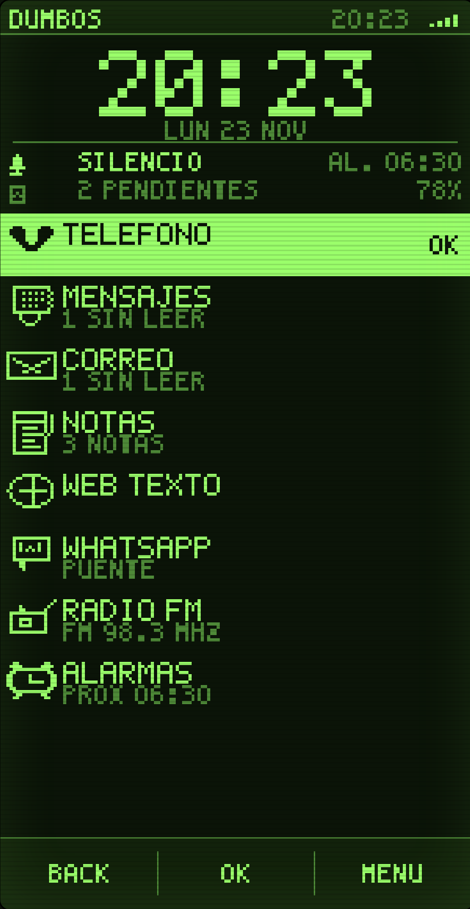
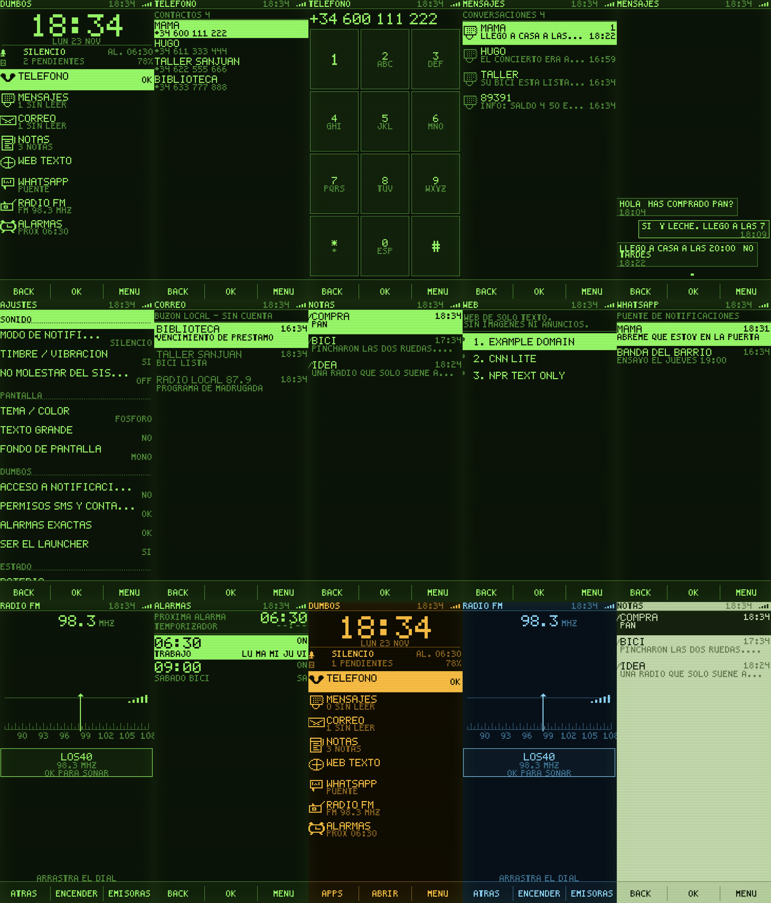
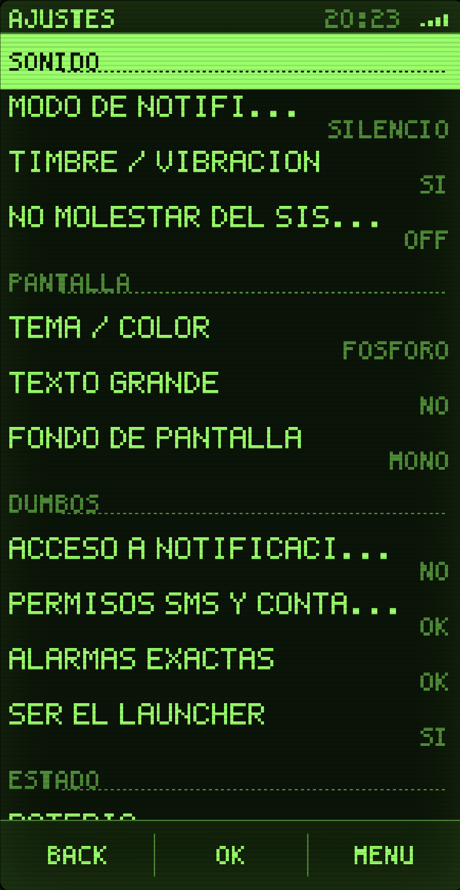
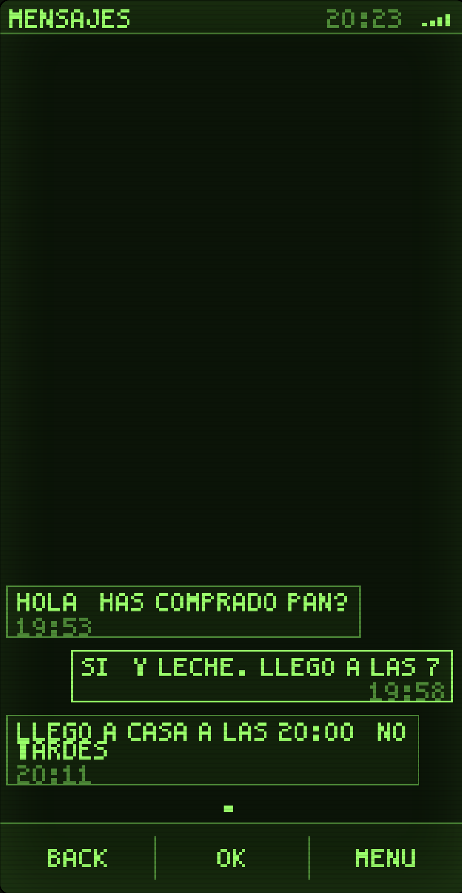
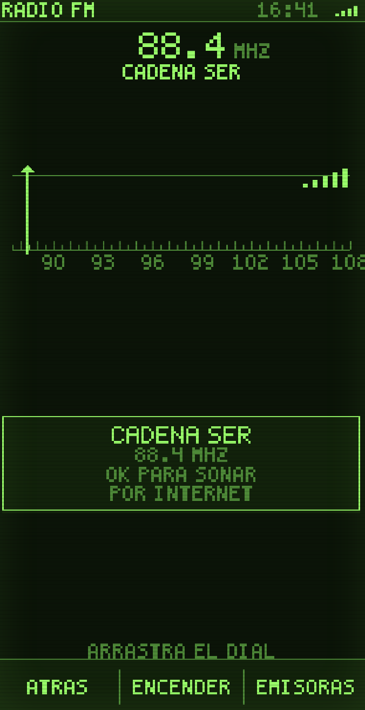
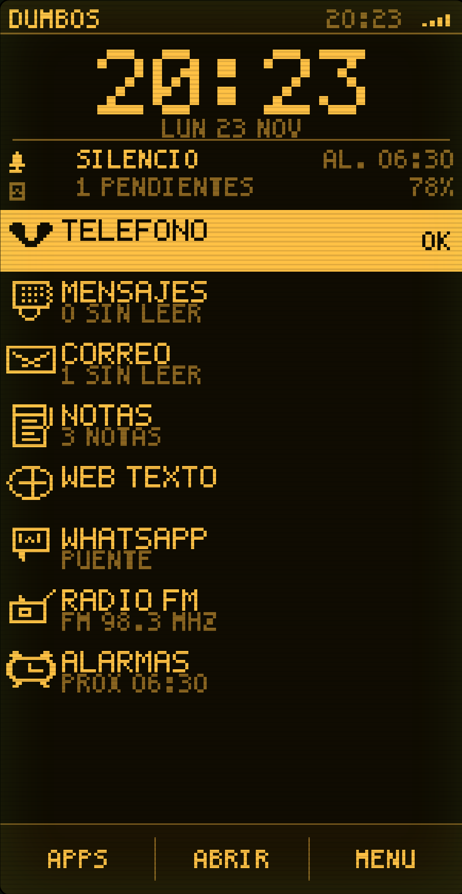
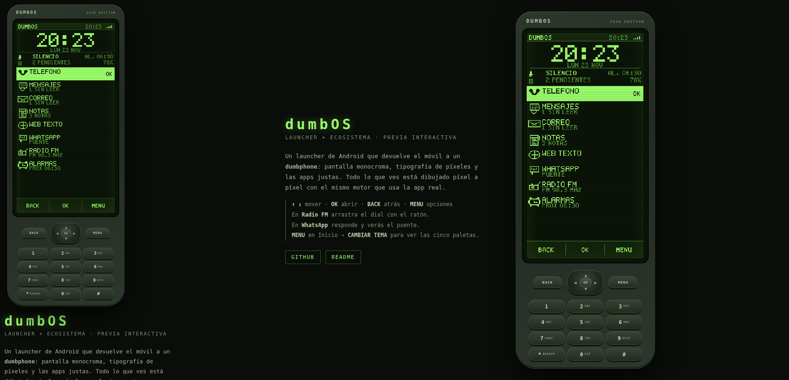
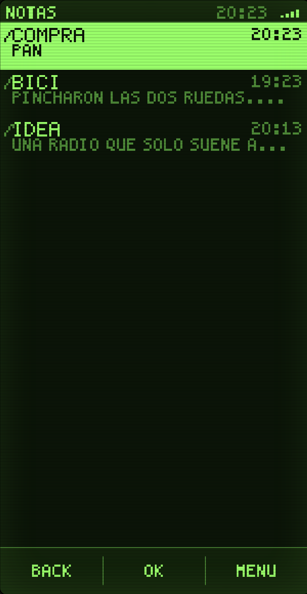
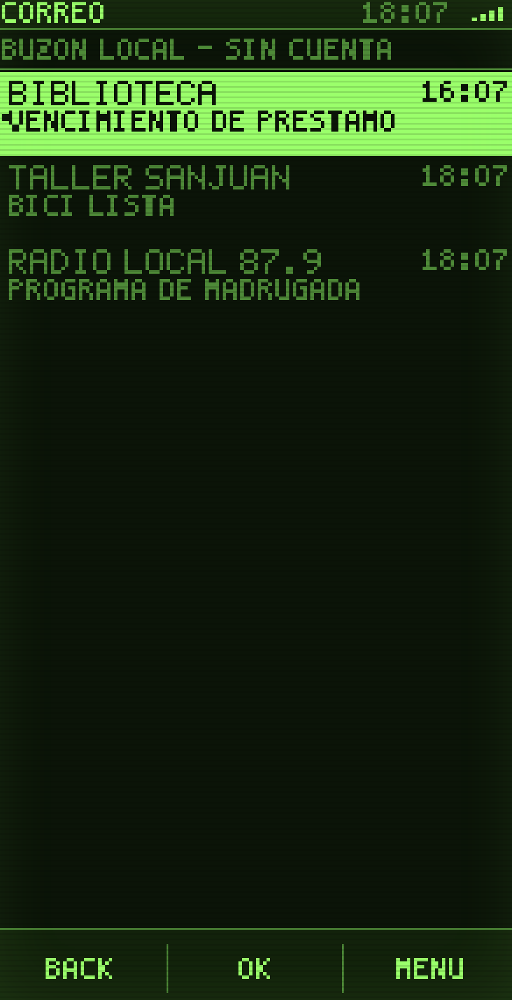
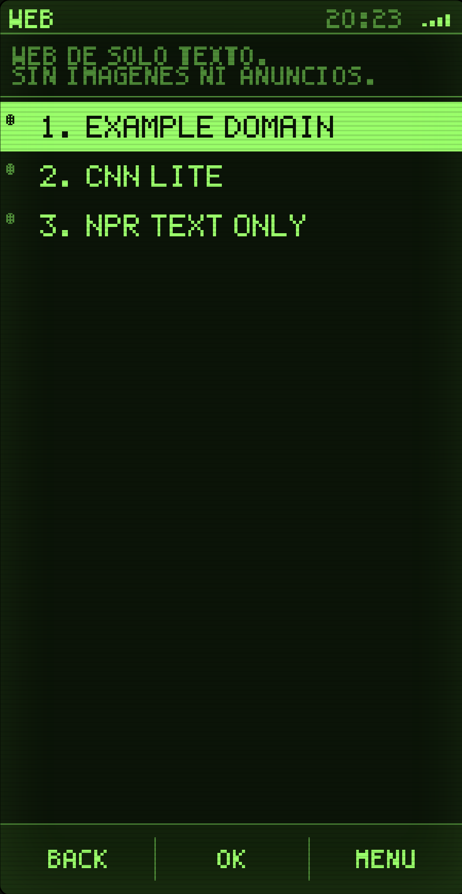

<div align="center">

# dumbOS

**Un launcher de Android que convierte el móvil en un dumbphone — sin dejar de ser un móvil.**

Monocromo · Tipografía de píxeles 5×7 · Iconos 16×16 · Sin animaciones, sin sombras, sin colores gritones

[`Vista previa`](#vista-previa-interactiva) · [`Descargar la APK`](#descargar-la-apk) · [`Las apps`](#las-nueve-apps) · [`Permisos`](#permisos-y-privacidad) · [`Arquitectura`](#arquitectura)

</div>





---

## Qué es esto

dumbOS es **una app de Android que actúa de launcher** y trae dentro su propio ecosistema:
teléfono, mensajes, correo, notas, navegador de texto, puente de WhatsApp, radio FM, alarmas y ajustes.
Todo comparte una única identidad visual inspirada en los **Nokia de los 90/2000**: 3310, 3210, 1100.

No es una skin. Es un motor de dibujo propio: una **fuente de mapa de bits 5×7** (más 4×6 para texto menudo),
**19 iconos de 16×16** dibujados píxel a píxel y **cinco paletas monocromas** (fósforo verde, ámbar, azul hielo, papel y monocromo).

| | |
|---|---|
|  |  |
|  |  |

## Vista previa interactiva

El repositorio incluye una **previa web jugable** del mismo motor (mismo mapa de bits, mismas medidas,
misma lógica de scroll y selección). Sirve para ver y probar dumbOS sin instalar la APK:

```bash
node web/serve.js 8080
# abre http://localhost:8080
```

O abre directamente **`web/dumbos.html`**: es la misma previa en un solo fichero, sin dependencias
(`python3 tools/inline_web.py` lo regenera desde las fuentes).

La previa se adapta a la ventana: el teléfono se escala para caber entero y, en pantallas estrechas,
pasa por delante del texto. Si lo ves cortado o "vacío", es que faltaba este ajuste; recarga la página.



La previa dibuja un teléfono 3310 completo: pantalla, dos teclas blandas, cruceta y teclado numérico
funcional. Todo responde al ratón, al tacto y al teclado real (`↑ ↓ ← →`, `Enter`, `Retroceso`, `M`, `0-9`, `*`, `#`).

Cosas que probar:

- **MENU → AJUSTES → TEMA / COLOR** para ver las cinco paletas. Tocar la cuadrícula de accesos rápidos con `←/→` también las previsualiza.
- **Radio FM**: arrastra la aguja y pulsa **OK**. Cada emisora memorizada es una emisora de verdad: la web reproduce su *stream* con `<audio>` y la APK lo conecta, lo decodifica y lo suena ella misma (`HttpURLConnection` → `MediaCodec` → `AudioTrack`). Si una emisora no responde, la pantalla dice **SIN SEÑAL** y deja de sonar; nunca hay estática fingida.
- **WhatsApp**: abre una conversación, pulsa **OK** y escribe; verás cómo se puentea la respuesta.
- **Navegador**: `MENU → IR A URL` abre páginas de demostración con el mismo motor de extracción de texto.

## Descargar la APK

Las versiones publicadas están en **[Releases](../../releases)**. La última es **v1.0.2**. Cada una trae:

| Fichero | Para qué |
|---|---|
| `dumbOS-v1.0.2.apk` | Release firmada. Instala esta. |
| `dumbOS-v1.0.2-debug.apk` | Depuración, convive con la anterior (paquete `.debug`). |
| `SHA256SUMS.txt` | Sumas para comprobar la descarga. |

Instalación: descarga el APK, ábrelo en el móvil (Android 8 o superior) y acepta instalar desde el
navegador. Después, **Ajustes → Aplicaciones → Aplicación de inicio → dumbOS**.

Si prefieres la última compilación de la rama, cualquier push deja los APK en el artefacto
**`dumbos-apks`** de la pestaña **Actions**.

### Firma

La clave de release está en el repositorio (`signing/dumbos-release.jks`, alias `dumbos`). Es
deliberado: dumbOS no tiene distribución detrás y una clave estable hace que las versiones se
instalen encima sin desinstalar. Antes de publicar algo serio, cambia la clave y guárdala en
privado.

```bash
keytool -list -v -keystore signing/dumbos-release.jks -storepass dumbos-release
# SHA-256: 87:1F:37:D3:77:0C:16:C1:49:D0:CC:F6:76:AC:79:B8:E7:24:40:DF:A5:B0:4C:0F:4E:63:4F:1A:38:BC:EB:C8
```

`apksigner verify --print-certs app-release.apk` confirma la firma; el workflow lo hace en cada
build y **falla si el firmante no es `CN=dumbOS`**.

### Qué comprueba CI sobre el APK

`tools/audit_apk.sh` corre en cada build y sobre la release publicada:

| Comprobación | Resultado de v1.0.0 |
|---|---|
| badging | `com.dumbos` v1.0.0, minSdk 26, targetSdk 34 |
| firma | v2 verificada, RSA 4096, `CN=dumbOS` |
| componentes del manifiesto | 16 declarados |
| clases en el DEX | 15/15 presentes (el alias resuelve a `HomeActivity`) |
| `zipalign -c 4` | correcto |
| tamaño | 764 KB |

La comprobación de clases es la que evita el fallo clásico: un componente declarado en el
manifiesto que el compilador no metió en el DEX instala bien y revienta al abrir.

`tools/test_pixels.py` corre antes de compilar y vigila las dos invariantes que hacían invisible
el texto:

- las máscaras de glifo son `ALPHA_8`, así que un píxel encendido se escribe `0xFF000000`
  (`255` es **transparente**: alfa 0, y el texto desaparece mientras los rectángulos se ven);
- `measure()` y `draw()` avanzan el mismo ancho para cada carácter.

`tools/test_render.js` comprueba además que la previa pinta de verdad (cuenta píxeles encendidos).

### Publicar una versión

```bash
git tag -a v1.0.0 -m "dumbOS 1.0.0"
git push origin v1.0.0
```

El workflow detecta el tag `v*`, compila, verifica la firma, genera las notas con
`tools/release_notes.py` (números sacados de los generadores, no escritos a mano) y crea la
release con los APK y las sumas adjuntas.

## Compilar la APK

Requisitos: **JDK 17** + **Android SDK** (compileSdk 34). No hay dependencias de terceros: solo framework APIs.

```bash
git clone https://github.com/greenhillsslick/DumbPhome && cd DumbPhome
gradle :app:assembleDebug          # o ./gradlew si generas el wrapper
# salida: app/build/outputs/apk/debug/app-debug.apk
```

- `minSdk 26` (Android 8) · `targetSdk 34`
- `applicationId com.dumbos`
- El workflow de **GitHub Actions** (`.github/workflows/build.yml`) compila `assembleDebug` y `assembleRelease` en cada push; los tags `v*` además publican la release.

### Verificar sin Gradle

En entornos sin Android SDK ni Gradle (por ejemplo, un sandbox) los Kotlin se pueden compilar contra un
`android.jar` real para detectar errores antes de tocar CI:

```bash
tools/check_compile.sh /ruta/a/android.jar /ruta/a/kotlinc
```

### Activar como launcher

Ajustes de Android → *Aplicaciones* → *Aplicación de inicio* → **dumbOS**.
Dentro de dumbOS: `Ajustes → SER EL LAUNCHER` abre ese panel.

## Las nueve apps

| App | Qué hace |
|---|---|
| **Inicio** | Reloj gigante, estado del día (modo de notificaciones, pendientes, batería), 8 accesos directos navegables con la cruceta, lista de todas las apps del sistema y búsqueda. |
| **Teléfono** | Agenda de contactos primero, teclado 3310 real (con letras y pulsación larga para marcar `+`), y pantalla de llamada en curso con temporizador. |
| **Mensajes** | Conversaciones SMS reales del sistema; hilo con burbujas que se paginan de tres en tres; envío con `SmsManager`. |
| **Ajustes** | Tres modos de notificación (**SILENCIO**, **NO MOLESTAR**, **TODO**), timbre, temas, permisos, alarmas exactas, launcher por defecto y estado. |
| **Correo** | Bandeja local con mensajes de ejemplo, lectura, redacción y entrega al proveedor de correo instalado (mailto). |
| **Notas** | Lista, lector y editor de texto plano, guardado local. |
| **Navegador** | Descarga HTTPS, quita *todas* las etiquetas, extrae el texto y una lista numerada de enlaces. Sin imágenes, sin scripts, sin cookies. |
| **WhatsApp** | Lee las notificaciones de WhatsApp/Telegram/Signal mediante el plugin de acceso a notificaciones y las muestra como texto; responde con el compositor de WhatsApp. |
| **Radio FM** | Dial arrastrable de 87.5 a 108 MHz con 13 emisoras memorizadas; reproduce su *stream* real (MP3/AAC) con decodificador propio, muestra lo que suena y para al salir. Sin datos, **SIN SEÑAL**. |
| **Alarmas** | Alarmas exactas que sobreviven al reinicio, repetición por días de la semana, temporizador, pantalla de alarma a pantalla completa con posponer. |

  

## La radio: por qué no es FM de verdad

Un teléfono Android no expone ningún sintonizador de FM a las aplicaciones. No es una limitación de
dumbOS: `android.jar` (API 34) no tiene ni una sola clase de radio, y las APIs internas de los chips
(`vendor.*`, `com.android.fmradio`) están vetadas para apps normales. Solo el firmware del fabricante
puede encender la antena FM; una app descargada de una APK no puede.

Así que la radio de dumbOS hace lo único honesto que puede hacer: **usa el dial para sintonizar
emisoras reales por internet**. Cada frecuencia memorizada es una emisora que existe, y al pulsar
**OK** el teléfono se conecta a su *stream* y lo decodifica él mismo:

```
https://…/emisora.mp3  →  HttpURLConnection (redirecciones, .m3u/.pls, ICY)
                       →  MediaCodec (MP3 / AAC / Vorbis)
                       →  AudioTrack (PCM 44,1 kHz estéreo)
```

Sin librerías de terceros, sin `MediaPlayer` opaco. Consecuencias de hacerlo así:

- La barra de estado dice la verdad: **CONECTANDO**, **SONANDO**, **PARADO** o **SIN SEÑAL: …**.
  Si el *stream* muere o no entrega audio durante 12 s, el decodificador se rinde y lo dice; no
  reproduce estática grabada para aparentar que hay señal.
- Necesita datos (wifi o móvil). La FM clásica no gastaba datos; esto sí. Es el precio de que suene.
- Las emisoras cambian de URL con el tiempo. El catálogo vive en `tools/stations.json`
  (`key/name/desc/freq/fmt/url`), y `python3 tools/gen_stations.py` genera desde ahí
  `app/.../radio/Stations.kt` y `web/stations.js`. **No edites esos dos ficheros a mano.**
- `python3 tools/check_streams.py` comprueba las 13 URLs desde la red real y saca una tabla. En CI
  corre en cada push (sin bloquear el build, porque una emisora puede estar en mantenimiento) y el
  resultado queda en el resumen del *workflow* y en un comentario del commit, que sí es
  legible desde cualquier sitio.

  Comprobado el 24-11-2026: **11 de 13** emisoras respondían. Las dos que faltaban eran
  EUROPA FM y MELODÍA FM, host de Atresmedia que devuelve 403 a peticiones de IP de centro
  de datos (no es el *User-Agent*: se probaron seis variantes y todas dan 403). ONDA CERO
  salva el bloqueo porque su redirección acaba en StreamTheWorld. Como una emisora que
  siempre dice SIN SEÑAL no merece una frecuencia, en 103.1 y 104.6 ahora están LOS40 DANCE
  y LOS40 CLASSIC, del mismo grupo, y la siguiente pasada del comprobador dictamina si
  responden. Mientras no lo diga un run en verde, no se afirma.

## Los modos de notificación

dumbOS reduce el ruido a tres estados que viven en `Ajustes`:

| Modo | Comportamiento |
|---|---|
| **SILENCIO** | Las notificaciones no interrumpen (filtro de interrupción *priority*); el modo de timbre pasa a vibración. Solo llamadas y alarmas. |
| **NO MOLESTAR** | Filtro de interrupción *none*: ni llamadas. La pantalla de alarmas sigue siendo una excepción. |
| **TODO** | El teléfono se comporta como un Android normal. |

## Permisos y privacidad

dumbOS solo pide lo que necesita para funcionar. **Nada sale del teléfono** salvo las páginas que abres en el navegador y los correos que decidas enviar.

| Permiso | Para qué |
|---|---|
| `READ_SMS`, `RECEIVE_SMS`, `SEND_SMS` | Mostrar y enviar tus mensajes. |
| `READ_CONTACTS` | Agenda de la app de teléfono. |
| `CALL_PHONE` | Marcar desde el marcador. |
| `POST_NOTIFICATIONS` | Aviso del propio dumbOS al recibir un SMS. |
| Acceso a notificaciones (opcional) | Puente de WhatsApp: leer los mensajes que esas apps ya notifican. |
| `SCHEDULE_EXACT_ALARM` / `USE_EXACT_ALARM` | Alarmas que suenan a la hora exacta. |
| `INTERNET` | Navegador de texto y correo. |

El acceso a notificaciones es **opcional**: sin él, WhatsApp muestra datos de ejemplo para que la app siga siendo explorable.

## Arquitectura

```
app/src/main/java/com/dumbos/
├── ui/        motor de dibujo: PixelWidgets (generado), Core (fuente, listas, teclas), Ui (shell)
├── core/      Prefs, Sms, Contacts, Mail, Notes, Alarms, Bridge, MiniWebClient, receivers
├── home/      HomeActivity: launcher
└── apps/      phone · sms · mail · notes · browser · whatsapp · radio · alarm · settings
```

- **Sin dependencias**: cero AndroidX, cero Kotlin externals. Todo son APIs de framework, lo que mantiene la APK mínima y el código auditable.
- **Dibujo propio**: `Typo` compone cada glifo desde un mapa de bits con `drawBitmap` sin suavizado; `PixelList` implementa scroll con imán a fila, selección invertida y paginación.
- **Cromo compartido**: todas las apps heredan de `OsActivity`, que aporta cabecera, barra de teclas blandas, diálogos y manejo de la cruceta/teclado.
- **Fuente y datos generados**: `tools/font_data.py` y `tools/icon_data.py` son la fuente de verdad; `tools/gen.py` genera `PixelWidgets.kt` **y** `web/pixel-widgets.js`, de forma que la APK y la previa no pueden divergir.
- **Todo en mayúsculas**: como un 3310. Los acentos se pliegan (`Á→A`) al dibujar y los símbolos tienen alias (`[OK]`, `[CHECK]`, `[BELL]`...).

## Estructura del repositorio

```
app/            la app Android (Kotlin, sin dependencias)
media/screens/  capturas reales de la previa
tools/          generadores de fuente/iconos y checker de compilación
web/            previa interactiva (HTML + canvas + WebAudio)
```

## Estado

- [x] Launcher con apps del sistema y búsqueda
- [x] Teléfono, mensajes, correo, notas, navegador, radio, alarmas, ajustes
- [x] Puente de WhatsApp por notificaciones
- [x] Temas (5 paletas) y modo de notificaciones
- [x] Previa web jugable
- [ ] Selector de canciones / reproductor (fuera del alcance de un dumbphone, por ahora)
- [ ] Envío de correo con cuenta propia (SMTP/IMAP) sin depender de otra app

---

Hecho para quien echa de menos mirar el móvil y no encontrar nada más que la hora.
